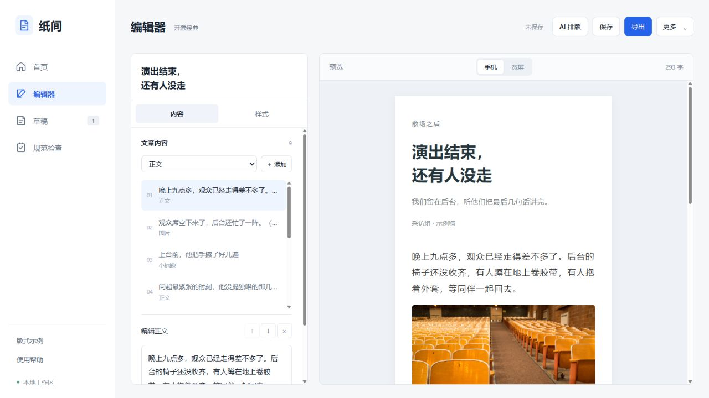

# 纸间 · Paper Studio

在本机编辑和排版微信公众号图文的轻量工具。支持模板、即时预览、草稿、HTML 导出，以及可配置的 AI 排版与参考推文功能。

**v0.8.0 公开预览版**。本地编辑与导出可独立使用；AI 需要自行配置模型；秀米自动化仍是实验功能。



## 能做什么

| 功能 | 当前状态 |
| --- | --- |
| 空白新稿、区块编辑、图片替换、排序与撤销 | 已实现，已做本机交互验证 |
| 即时预览、主题切换、窄屏编辑/预览切换 | 已实现，已验证桌面与390像素布局 |
| 本地草稿、TXT/简化 Markdown/JSON 导入、JSON 备份 | 已实现 |
| 含图片的独立 HTML 导出 | 已实现 |
| 公开推文链接或 HTML 参考排版 | 已实现；网页限制可能导致读取失败 |
| AI 辅助排版、对比、修订、另存方案 | 已实现接口与内容校验；真实模型效果和服务兼容性待更多验证 |
| 发送到秀米新草稿 | 实验；曾有本机成功记录，不保证其他环境可用 |
| 秀米草稿规范检查、在副本上修正 | 实验；新自动作业完整保存流程尚待真实验收 |
| 版式示例页 | 视觉小样，不支持编辑或导出 |

项目没有账号系统、多人隔离或公网部署支持。不会直接向微信公众号发布文章。

## 快速开始

需要 **Python 3.11 或更新版本**。普通使用不需要 Node.js，也不需要构建前端。

```bash
git clone https://github.com/S1LenTcg/paper-studio.git
cd paper-studio
```

### Windows

在项目目录中执行：

```powershell
python -m venv .venv
.\.venv\Scripts\python.exe -m pip install -e .
.\.venv\Scripts\python.exe -m paperstudio.server --open
```

依赖装好后，也可双击 `启动纸间.cmd`。

### macOS / Linux

```bash
python3 -m venv .venv
.venv/bin/python -m pip install -e .
.venv/bin/python -m paperstudio.server --open
```

浏览器访问 [http://127.0.0.1:8765](http://127.0.0.1:8765)。关闭服务时，在终端按 Ctrl+C。

端口被占用时追加 `--port 8766`；可用 `--data-dir ./my-data` 指定数据目录。

## 第一篇文章

1. 首页点击“手动排版”，输入标题和正文。
2. 在“内容”面板增加小标题、引用、图片等区块；在“样式”面板选择主题和调整间距。
3. 对照预览继续修改。文章会自动保存，也可点击“保存”或按 Ctrl+S。
4. 点击“导出”，下载含图片的排版 HTML，或备份 JSON 文稿。

“查看示例”用于体验已有排版；“手动排版”创建空白稿。详细操作见 [使用说明](docs/usage.md)。

## AI 与秀米

- **AI**：在 AI 排版窗口配置 Chat Completions 兼容的 HTTPS API、模型与密钥。文稿文字和图片说明会发送到配置的服务；图片文件不随请求发送。密钥仅留在本次服务内存中。服务费用由所选模型提供方收取。
- **秀米**：需要 Chrome、可选 Selenium 依赖，以及外部 `all-to-xiumi` 源码。首次需要在工具打开的专属窗口手动登录，不复用日常浏览器资料。请先阅读 [秀米实验接入](docs/xiumi.md)。
- 保存或另存结果不明确时，先打开秀米检查；工具不会自动重复创建草稿。

## 数据与隐私

源码运行时，用户数据默认在项目的 `data/` 中。安装包运行时，默认使用当前用户的应用数据目录；也可通过 `--data-dir` 或 `PAPER_STUDIO_DATA_DIR` 指定位置。

草稿、导出、任务日志和可选的专属浏览器资料不应提交到 Git。仓库已忽略 `data/`、环境文件、日志、构建产物及本地验收目录。服务仅监听本机，并检查 Host/Origin；请在可信本机环境使用。

## 开发与反馈

- [开发、测试与打包](docs/development.md)
- [验证记录](docs/validation.md)
- [已知限制](docs/limitations.md)
- [报告问题](https://github.com/S1LenTcg/paper-studio/issues)

提交问题时，请移除 API Key、登录二维码、Cookie、完整私人文稿及浏览器资料。

## 来源与许可

原创代码采用 [MIT](LICENSE)。第三方主题、摄影及可选秀米适配器保持各自许可，见 [第三方声明](THIRD_PARTY_NOTICES.md)。本项目与微信、秀米及所引用开源项目没有官方关联。
